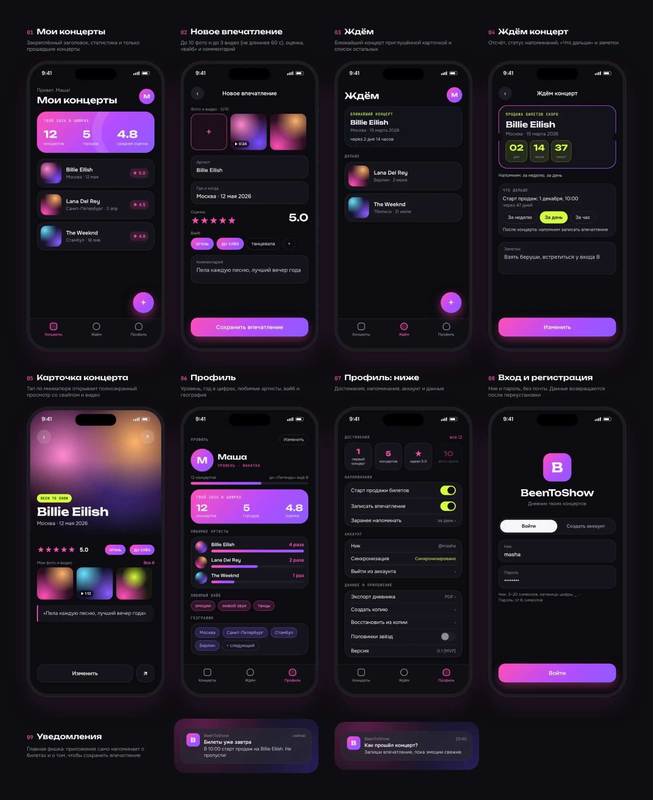
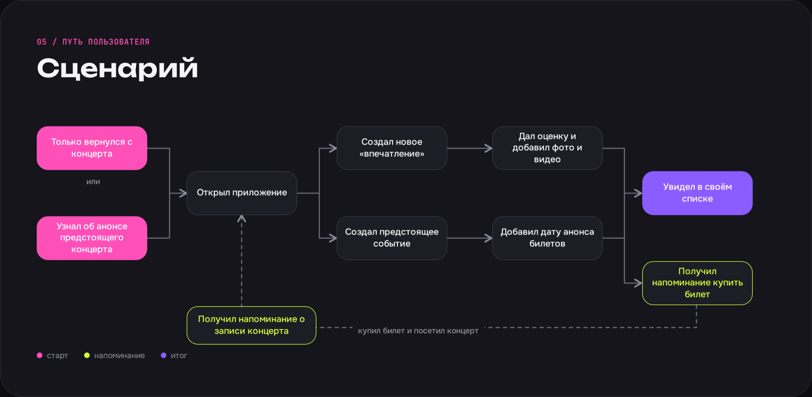
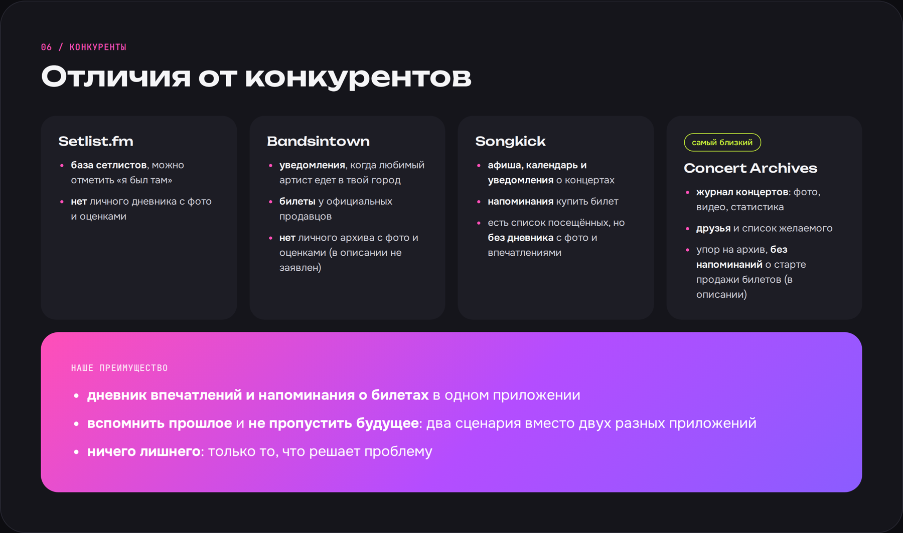

# BeenToShow

Дневник концертов для iPhone: записывай впечатления, оценки, фото и видео, жди будущие концерты и получай напоминания о старте продажи билетов.

*A concert diary for iOS: log impressions, ratings, photos and videos, track upcoming shows and get ticket-sale reminders.*

## Дизайн

Макеты экранов, из которых делалось приложение (дизайн, не снимки готовой сборки: детали интерфейса в приложении могут отличаться).

### Путь пользователя

### Чем отличается от аналогов

## Возможности

- Дневник прошедших концертов: артист, город, дата, оценка, «вайб», комментарий, до 10 фото и до 3 видео
- Раздел «Ждём»: отсчёт до концерта, заметки, старт продаж и локальные уведомления
- Профиль: статистика, уровни, 12 достижений, любимые артисты, география
- Экспорт дневника в PDF
- Резервная копия и восстановление через «Файлы» (в том числе iCloud Drive)
- Аккаунт по нику и паролю с синхронизацией через Supabase: данные возвращаются после переустановки
- Оффлайн-очередь синхронизации, защита от потери данных при выходе из аккаунта

## Стек

SwiftUI, Swift Concurrency (async/await, actors), `@Observable`, UserNotifications, PhotosUI, AVKit, Keychain, Supabase (Auth, PostgREST, Storage) через чистый `URLSession`, без сторонних зависимостей.

Шрифты: Unbounded и Onest (SIL Open Font License).

## Как собрать

1. Открой `ConcertLog.xcodeproj` в Xcode.
2. Создай проект на [supabase.com](https://supabase.com), в Authentication -> Providers -> Email выключи «Confirm email».
3. В SQL Editor выполни `supabase_setup.sql` (по желанию `supabase_hardening.sql`).
4. Скопируй `Secrets.example.swift` в `ConcertLog/Secrets.swift` и подставь Project URL и publishable key.
5. Выбери свою команду в Signing & Capabilities и запускай.

## Архитектура синхронизации

Данные хранятся локально и в Supabase (RLS: каждый видит только свои строки). Правки попадают в очередь, которая переживает офлайн и перезапуск. Удаление передаётся «надгробиями». При выходе из аккаунта несинхронизированные правки не стираются молча, при смене пользователя на устройстве локальные данные предыдущего не попадают в чужой аккаунт.

## Лицензия

Код под лицензией MIT, см. `LICENSE`.
